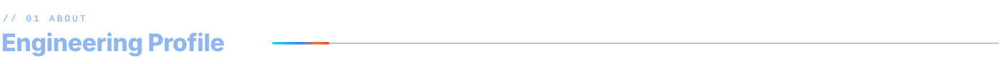
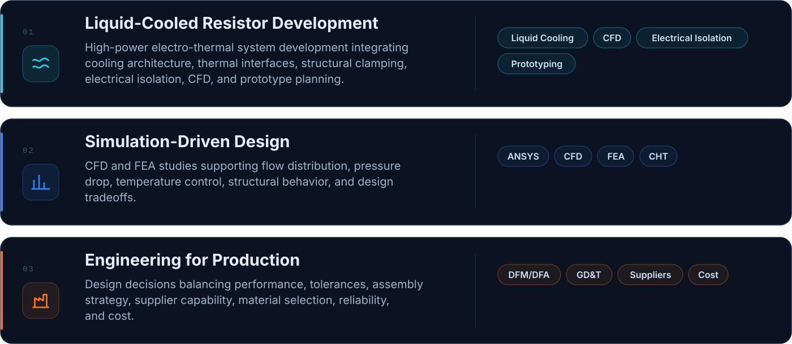
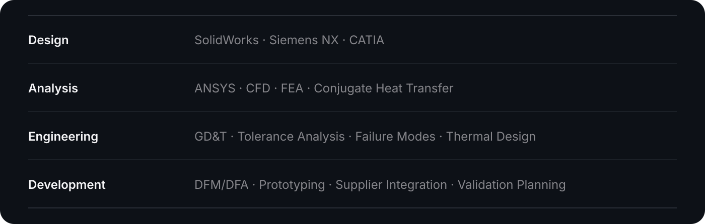

  

  
  
  

 

I develop **thermal and electro-mechanical hardware** for demanding operating environments. My work spans the full path from **concept → analysis → prototype validation → manufacturing coordination → production**.

Primary interests: liquid cooling, high-power thermal systems, thermal interfaces, mechanical reliability, and simulation-driven product development.

 

  

 

  

 

  

 

  

  © 2026 Joaquin Coaquira. All rights reserved.

